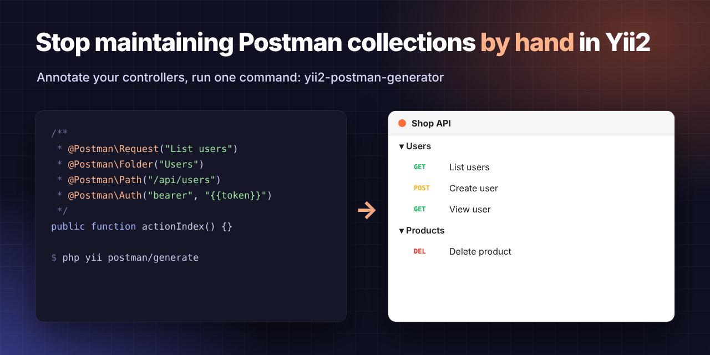

# Yii2 Postman Generator

[](https://github.com/dannyrios81/yii2-postman-generator/actions/workflows/tests.yml)
[](https://packagist.org/packages/iguazoft/yii2-postman-generator)
[](https://packagist.org/packages/iguazoft/yii2-postman-generator)
[](https://php.net/)
[](LICENSE)

**Keep your Postman collection in sync with your Yii2 API.** Annotate your controller actions, run one command, and import the result into Postman, Insomnia, Bruno or Hoppscotch.

No OpenAPI spec to write and maintain, no extra dependencies: only Yii2.

[Leer en español](README.es.md)



```php
/**
 * @Postman\Request("Create user")
 * @Postman\Folder("Users")
 * @Postman\Method("POST")
 * @Postman\Path("/api/users")
 * @Postman\Auth("bearer", "{{token}}")
 * @Postman\Body({"name": "John Doe", "email": "john@example.com"})
 * @Postman\Test("status", "201")
 * @Postman\Test("json", "data.id")
 */
public function actionCreate() { /* ... */ }
```

```bash
$ php yii postman/generate
Scanning:
  - /var/www/app/controllers

✓ 12 request(s) written to /var/www/app/docs/api.postman_collection.json
```

See a full generated file in [`docs/example.postman_collection.json`](docs/example.postman_collection.json).

## Why

- **The docs live next to the code.** When you change an endpoint, the annotation is right there.
- **One command, repeatable.** Run it in CI and commit the JSON, so the collection never drifts.
- **Postman Collection v2.1.** It imports into Postman, Insomnia, Bruno, Hoppscotch and anything else that reads that format.
- **Lightweight.** Unlike Swagger/OpenAPI tooling, you only describe what a client needs to call the endpoint.

## Installation

```bash
composer require --dev iguazoft/yii2-postman-generator
```

The extension registers the `postman` console command automatically through Yii2's extension bootstrap. Nothing to configure.

## Usage

### 1. Annotate your controllers

```php
<?php

namespace app\controllers;

use yii\rest\Controller;

/**
 * @Postman\Collection("Shop API")
 * @Postman\Description("Public API used by the mobile app")
 * @Postman\BaseUrl("https://api.shop.test")
 * @Postman\Variable("apiVersion", "v1")
 */
class UserController extends Controller
{
    /**
     * @Postman\Request("List users")
     * @Postman\Folder("Users")
     * @Postman\Path("/api/users")
     * @Postman\Auth("bearer", "{{token}}")
     * @Postman\Query("page", "1")
     * @Postman\Query("per-page", "20")
     */
    public function actionIndex() { /* ... */ }

    /**
     * @Postman\Request("View user")
     * @Postman\Folder("Users")
     * @Postman\Path("/api/users/{id}")
     */
    public function actionView($id) { /* ... */ }
}
```

Only actions with `@Postman\Request` are exported.

### 2. Generate

```bash
php yii postman/generate
```

| Option | Alias | Default | Description |
|---|---|---|---|
| `--output` | `-o` | `@app/docs/api.postman_collection.json` | Output file. Yii aliases allowed. |
| `--dirs` | `-d` | `@app/controllers` | Comma separated directories, scanned recursively. |
| `--name` | `-n` | `@Postman\Collection` or `API Collection` | Collection name. |
| `--base-url` | `-u` | `@Postman\BaseUrl` or `http://localhost` | Value of `{{baseUrl}}`. |
| `--include-hidden` | `-a` | `false` | Also export actions marked `@Postman\Hidden`. |

```bash
php yii postman/generate -d=@app/modules/api/v1/controllers,@app/modules/api/v2/controllers -o=@app/docs/api.json
php yii postman/help   # annotation reference
```

### 3. Import

In Postman: **Import → File → `api.postman_collection.json`**. Set `token` in the collection variables and you are ready.

## Annotation reference

### Class level

| Annotation | Description |
|---|---|
| `@Postman\Collection("Name")` | Collection name. The first one found wins. |
| `@Postman\Description("Text")` | Collection description. |
| `@Postman\BaseUrl("https://api.example.com")` | Default value of `{{baseUrl}}`. |
| `@Postman\Variable("key", "value")` | Collection variable. Repeatable. |
| `@Postman\Test(...)` | Test applied to every action of the controller. See [Tests](#tests). |

### Action level

| Annotation | Description |
|---|---|
| `@Postman\Request("Name")` | **Required.** Request name. |
| `@Postman\Method("POST")` | HTTP method. Default `GET`. |
| `@Postman\Path("/api/users/:id")` | Path. `:id` and `{id}` become Postman path variables. |
| `@Postman\Folder("Users")` | Folder to group the request in. |
| `@Postman\Description("Text")` | Request description. |
| `@Postman\Auth("bearer", "{{token}}")` | Bearer token. |
| `@Postman\Auth("basic", "{{user}}", "{{pass}}")` | Basic auth. |
| `@Postman\Auth("apikey", "X-Api-Key", "{{apiKey}}")` | API key header. |
| `@Postman\Body({...})` | JSON body. Can span several lines. |
| `@Postman\Header("key", "value")` | Request header. Repeatable. |
| `@Postman\Query("key", "value")` | Query parameter. Repeatable. |
| `@Postman\Hidden` | Not exported unless `--include-hidden`. |
| `@Postman\Test(...)` | Test script assertion. Repeatable. See [Tests](#tests). |

Arguments can use double quotes, single quotes, or no quotes. Quoted values may contain commas and parentheses. Escape a quote inside a quoted value with a backslash: `"John \"Johnny\" Doe"`.

### Tests

`@Postman\Test` adds assertions to the request's **Tests** script, so the collection checks your API, not only calls it. Postman runs them after each request; [Newman](https://github.com/postmanlabs/newman) runs them in CI.

| Annotation | Generated assertion |
|---|---|
| `@Postman\Test("status", "201")` | Status code is 201. |
| `@Postman\Test("json", "data.id")` | The JSON body has `data.id` (dot path, `items[0].id` works too). |
| `@Postman\Test("json", "data.active", "true")` | ... and it equals `true`. Valid JSON (`true`, `42`, `null`, `"42"`, `[1,2]`) keeps its type; anything else is compared as a string. |
| `@Postman\Test("header", "Content-Type")` | The response has the header. |
| `@Postman\Test("header", "X-Api-Version", "2")` | ... with this exact value. |
| `@Postman\Test("time", "500")` | Response time is below 500 ms. |
| `@Postman\Test("contains", "created")` | The body text contains the string. |

Tests on the **class** apply to every action of that controller; action tests are added after them. An action `status` or `time` test replaces the class one, so a controller can expect `200` while its `actionCreate` expects `201`.

```php
/**
 * @Postman\Test("status", "200")
 * @Postman\Test("header", "Content-Type", "application/json; charset=UTF-8")
 */
class UserController extends Controller
{
    /**
     * @Postman\Request("Create user")
     * @Postman\Method("POST")
     * @Postman\Path("/api/users")
     * @Postman\Test("status", "201")
     * @Postman\Test("json", "data.id")
     * @Postman\Test("time", "500")
     */
    public function actionCreate() { /* ... */ }
}
```

Generated script for `Create user`:

```js
pm.test("Header Content-Type is application/json; charset=UTF-8", function () { pm.response.to.have.header("Content-Type", "application/json; charset=UTF-8"); });
pm.test("Status code is 201", function () { pm.response.to.have.status(201); });
pm.test("Response has data.id", function () { pm.expect(pm.response.json()).to.have.nested.property("data.id"); });
pm.test("Response time is below 500 ms", function () { pm.expect(pm.response.responseTime).to.be.below(500); });
```

A typo (`@Postman\Test("statuss", "200")`) or a missing value stops the command with the controller and action name and exit code 65, so CI fails instead of exporting a collection without the test.

## Programmatic use

```php
use iguazoft\postman\PostmanGenerator;

$generator = new PostmanGenerator([
    'scanDirs' => ['@app/controllers', '@app/modules/api/controllers'],
    'collectionName' => 'My API',              // optional, overrides @Postman\Collection
    'variables' => ['baseUrl' => 'https://api.example.com'],
    'includeHidden' => false,
]);

$generator->generate('@app/docs/api.postman_collection.json'); // write a file
$json = $generator->generateJson();                           // or get the JSON
$array = $generator->generateArray();                         // or the array
```

## Keep it in sync with CI

```yaml
# .github/workflows/postman.yml
- run: php yii postman/generate -o=@app/docs/api.postman_collection.json
- run: git diff --exit-code docs/api.postman_collection.json || (echo "Run php yii postman/generate and commit the result" && exit 1)
```

Run the `@Postman\Test` assertions against a test server with Newman:

```yaml
# .github/workflows/api-tests.yml (after starting your API on port 8080)
- run: php yii postman/generate -o=@app/docs/api.postman_collection.json
- run: npx newman run docs/api.postman_collection.json --env-var "baseUrl=http://localhost:8080" --env-var "token=${{ secrets.API_TEST_TOKEN }}"
```

## Requirements

- PHP 7.4 to 8.4
- Yii 2.0

## Contributing

Issues and pull requests are welcome.

```bash
composer install
composer test
```

## License

MIT. See [LICENSE](LICENSE).
